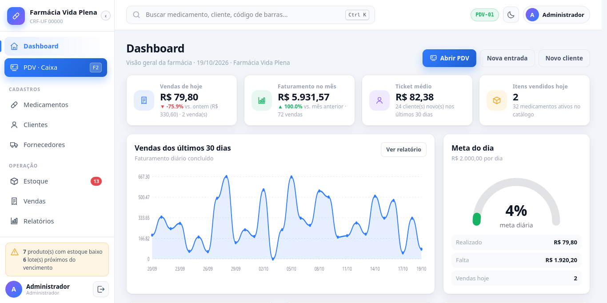
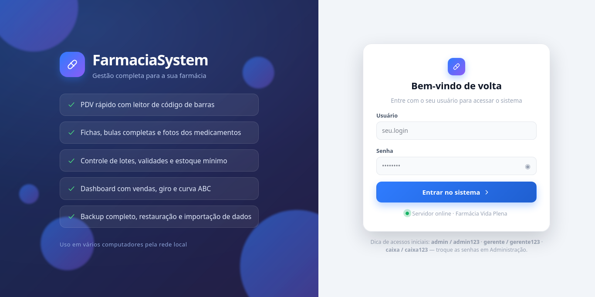
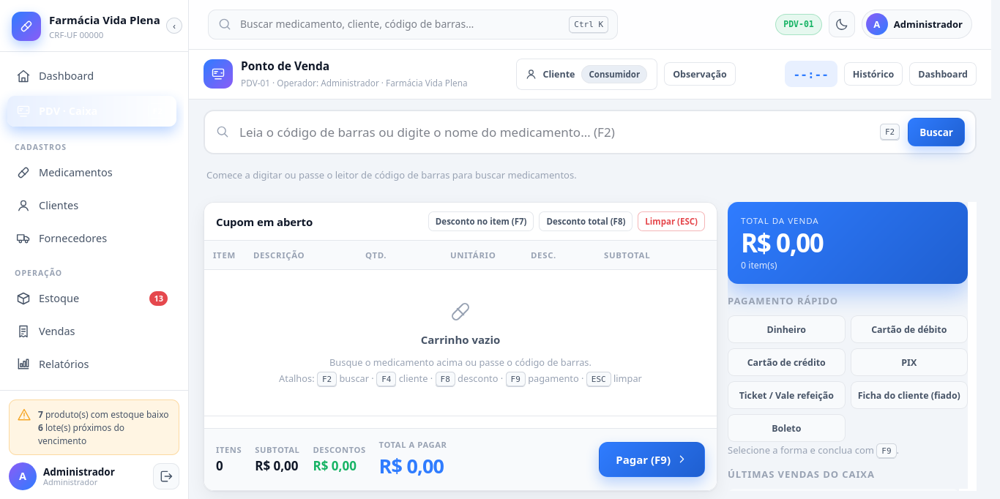
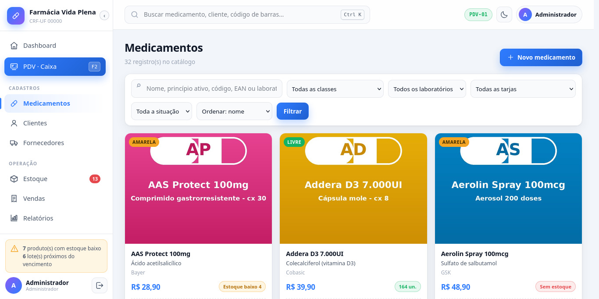
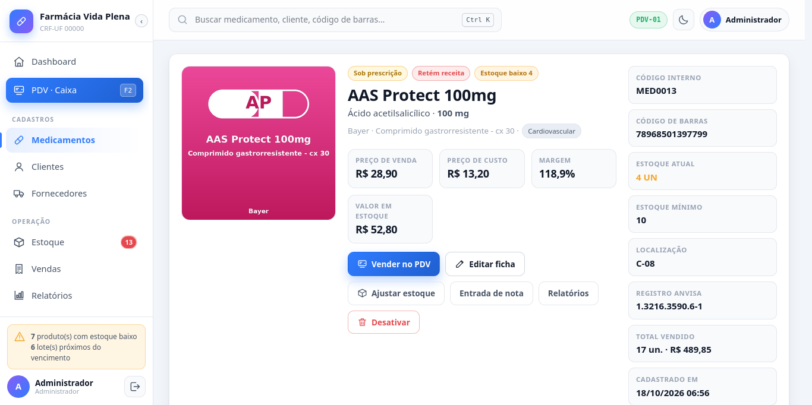
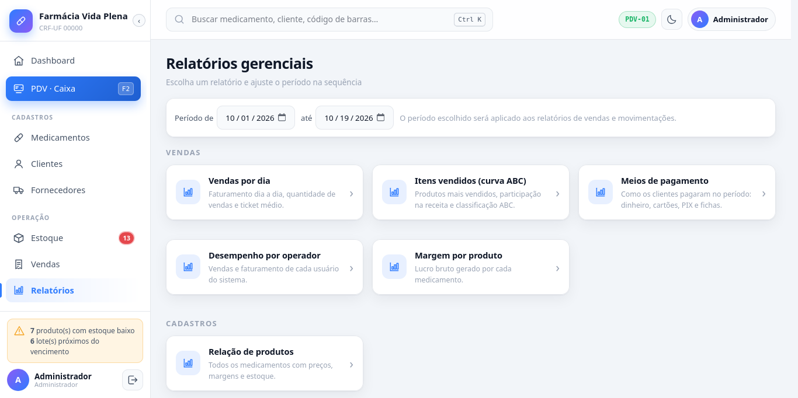
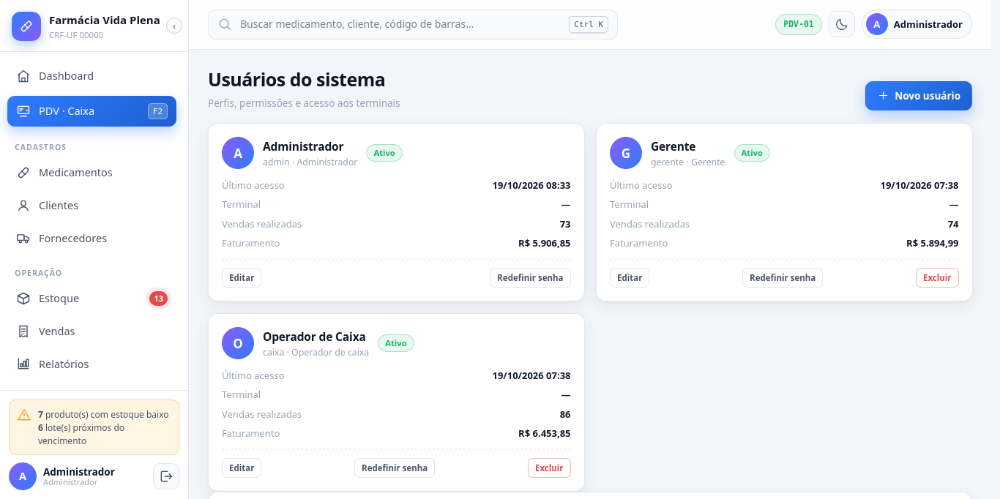

# 💊 FarmaciaSystem

Sistema completo de gestão de farmácia, em português: **PDV, estoque por lote e validade (FIFO), cadastros com foto e bula, clientes, fornecedores, fichas de pagamento, 13 relatórios com gráficos, backup/restauração e impressão de cupons térmicos 58/80 mm** — com interface moderna, tema claro/escuro, **100% offline (zero CDN)** e acessível de vários computadores pela rede local.

Feito em **Python (Flask) + SQLite**: não precisa instalar banco de dados, IIS, Apache nem nada além do Python.



---

## 📸 Telas do sistema

<table>
  <tr>
    <td width="50%"><br><b>Login</b> — sessão por terminal, dica de acessos</td>
    <td width="50%"><br><b>PDV</b> — busca/código de barras, pagamento rápido</td>
  </tr>
  <tr>
    <td><br><b>Medicamentos</b> — catálogo com filtros e fotos</td>
    <td><br><b>Ficha do produto</b> — preço, margem, lotes, bula</td>
  </tr>
  <tr>
    <td><br><b>Relatórios</b> — 13 relatórios com gráficos e CSV</td>
    <td><br><b>Administração</b> — usuários, perfis e permissões</td>
  </tr>
</table>

---

## ✨ Recursos

### 🖥️ PDV (frente de caixa)
* Busca por nome, princípio ativo, código, EAN ou **código de barras** (leitor de barras = digitar e Enter).
* Carrinho que **sobrevive a fechar a aba** (salvo por terminal).
* Dinheiro (com troco), cartão de débito/crédito (com parcelamento), Pix, boleto, ticket/vale e **ficha (fiado)** com limite de crédito.
* Desconto por item, desconto total e observações na venda.
* Cupom térmico na hora (veja [Impressão](#-impressão-de-cupom-térmico-58-mm-e-80-mm)).

**Atalhos de teclado:**

| Tecla | Função |
|---|---|
| `F2` | Focar a busca de medicamentos |
| `F4` | Selecionar cliente |
| `F7` | Desconto no item |
| `F8` | Desconto total |
| `F9` | Ir para o pagamento / finalizar |
| `ESC` | Limpar o cupom |
| `Ctrl+K` | Busca global (topo, em qualquer tela) |

### 📦 Estoque por lote e validade
* Entrada de nota fiscal com lote, validade, custo, preço e fornecedor.
* **Baixa automática por FIFO** — o lote vencendo primeiro sai primeiro.
* Alertas de estoque baixo e lotes vencendo em 60 dias (dashboard e menu).
* Saída manual, ajuste por inventário e sugestão de compra — tudo auditado.

### 💊 Medicamentos
* Foto da caixa (várias por produto), **bula completa** (indicações, posologia, contraindicações, reações adversas, interações, gravidez, sobredosagem, armazenamento, excipientes).
* Princípio ativo, laboratório, classe terapêutica, tarja, registro ANVISA, EAN, estoque mínimo e localização.
* Ficha com abas: **bula · lotes · movimentações · histórico de vendas · fotos**.

### 👥 Clientes, fornecedores e fichas
* Cadastro com CPF/CNPJ, contato, endereço e busca rápida.
* **Ficha de pagamento (fiado)** com limite de crédito, parcelas e baixa parcela a parcela.
* Fornecedores com histórico de entradas de mercadoria.

### 🧾 Vendas
* Histórico com filtros, detalhe da venda, reimpressão de cupom.
* Cancelamento controlado (exige digitar o número da venda — fica na auditoria).

### 📊 Relatórios (13, com gráficos e exportação CSV)
* **Vendas:** por dia · itens vendidos (curva ABC) · meios de pagamento · desempenho por operador · margem por produto
* **Cadastros:** relação de produtos
* **Estoque:** posição de estoque · produtos para reposição · validade dos lotes · entradas de mercadoria
* **Pessoas:** clientes · fichas de clientes
* **Sistema:** log de atividades (auditoria — só admin)

Gráficos são **SVG desenhados pelo servidor** (`charts.py`) — funcionam offline, sem bibliotecas de frontend.

### 💾 Backup compatível com o mercado
* **`.zip` completo** (banco + fotos + manifesto) — é só guardar em pendrive/nuvem.
* Restauração por upload ou pelo histórico, com confirmação digitando `RESTAURAR` e **backup de segurança automático antes**.
* Exportação **JSON** e **CSV de todas as tabelas** (abre no Excel).
* **Importação de outros sistemas:** envie o CSV/TXT/JSON (ou Excel) exportado do seu sistema atual — o mapeamento das colunas é detectado automaticamente, você revisa e importa.

### 🖨️ Impressão de cupom térmico (58 mm e 80 mm)
Página HTML própria com `@page` no tamanho certo — funciona com **qualquer impressora comum** configurada no navegador, **sem instalar driver de ESC/POS**. Basta marcar “imprimir sem cabeçalho/rodapé” no diálogo do navegador.

### 🔐 Segurança
* Login obrigatório, senhas com **hash** (Werkzeug), **CSRF** em formulários, sessão por terminal.
* Trilha de **auditoria completa**: quem fez o quê, quando (relatório e tela próprios).
* Perfis com permissões por módulo (veja abaixo).

### 🎨 Interface
* Tema **claro/escuro** (botão no topo, lembrado no navegador).
* Layout responsivo — funciona em PC, notebook e tablet.
* Toasts de aviso, confirmações e estados de vazio em todas as telas.

---

## 🚀 Como instalar e rodar

### Requisito único
* **Python 3.10 ou superior** — baixe em [python.org](https://www.python.org/downloads/) (no Windows, marque *“Add python.exe to PATH”* na instalação).

### Windows
```
clique duplo em iniciar.bat
```
Na primeira execução ele mesmo cria o ambiente virtual e instala Flask + Pillow. Depois é só abrir o navegador em `http://localhost:5000`.

### Linux / macOS
```bash
chmod +x iniciar.sh      # só na primeira vez
./iniciar.sh             # porta 5000
./iniciar.sh 8080        # outra porta
```

### Manualmente (qualquer sistema)
```bash
python3 -m venv venv
venv/bin/pip install -r requirements.txt      # Windows: venv\Scripts\pip
python3 run.py                                # Windows: python run.py
```

### Opções

| Como | Efeito |
|---|---|
| `./iniciar.sh 8080` / `iniciar.bat 8080` | Sobe em outra porta |
| `FARMACIA_PORTA=8080 python3 run.py` | Idem, por variável de ambiente |
| `FARMACIA_DADOS=/caminho python3 run.py` | Move banco/fotos/backups de lugar |
| `python3 run.py --debug` | Modo desenvolvimento (recarrega ao salvar) |

---

## 🌐 Acessando de outros computadores da rede

O servidor escuta em **todas as interfaces**. Ao iniciar, ele mostra o endereço para as outras máquinas:

```
  Servidor local : http://127.0.0.1:5000
  Rede local     : http://192.168.0.220:5000   <-- use nas outras máquinas
```

Basta digitar esse endereço no navegador de qualquer PC/tablet da farmácia (mesmo Wi-Fi). **Nada é preciso instalar nos clientes.**

> Dica: fixe um IP para a máquina no roteador (reserva DHCP) para o endereço nunca mudar. Se os outros PCs não abrirem, libere a porta no firewall (`sudo ufw allow 5000` ou painel do Windows).

---

## 🔑 Primeiro acesso

Na primeira execução o sistema se auto-popula com **dados de exemplo reais**: 28 medicamentos com foto e bula, 3 fornecedores, 22 clientes, lotes e ~230 vendas dos últimos 60 dias — o dashboard já abre cheio.

| Perfil  | Login     | Senha        | O que pode fazer |
|---------|-----------|--------------|------------------|
| **Admin**   | `admin`   | `admin123`   | Tudo: configurações, usuários, backup, importação, auditoria |
| **Gerente** | `gerente` | `gerente123` | Cadastros, estoque, relatórios, vendas, fichas (sem administração) |
| **Caixa**   | `caixa`   | `caixa123`   | PDV, vendas, clientes, fichas e **consulta** de medicamentos |

> ⚠️ **Troque as senhas** em *Administração → Usuários* antes de usar a sério.
> Se apagar a pasta `data/` o sistema recria tudo do zero (útil para recomeçar com dados de exemplo).

---

## 📖 Guia de uso

### 1. Dashboard
Primeira tela após o login. Mostra vendas de hoje, faturamento do mês, ticket médio, gráfico dos últimos 30 dias, meta do dia, alertas de **estoque baixo** e **lotes próximos do vencimento**, e atalhos para as ações do dia.

### 2. PDV · Caixa (`F2`)
1. Leia o **código de barras** ou digite o nome do medicamento e escolha o item.
2. Ajuste quantidade, aplique desconto (`F7`/`F8`) e, se quiser, vincule um **cliente** (`F4`).
3. Escolha a forma de pagamento (atalho `F9`): dinheiro, cartão, Pix, vale ou **ficha do cliente**.
4. Finalize — o **cupom térmico** abre pronto para imprimir (`Ctrl+P`) e a venda entra no histórico.

> O carrinho é salvo por terminal: se fechar a aba sem finalizar, ele volta ao reabrir o PDV.

### 3. Medicamentos
* **Catálogo** (`Medicamentos`): busca + filtros por classe, laboratório, tarja e situação.
* **Novo medicamento**: dados cadastrais, preços (o sistema calcula a margem), estoque mínimo e localização.
* **Ficha do produto**: abas com bula, lotes, movimentações e histórico de vendas; botões para *Vender no PDV*, *Editar*, *Ajustar estoque*, *Entrada de nota* e *Desativar*.

### 4. Estoque
* **Entrada de nota**: selecione o produto/fornecedor e informe lote, validade e quantidades — o lote nasce aqui.
* **Saída / Ajuste**: baixas manuais e correções de inventário, sempre com motivo auditado.
* Painel com saldo por produto, alertas de reposição e validade.

### 5. Clientes e fichas
* Cadastro completo; na ficha do cliente há **limite de crédito** e situação do fiado.
* **Ficha de pagamento**: crie a conta (parcelas) e dê baixa parcela a parcela.
* Extrato do cliente via API (`/api/<cliente>/extrato`), usado na tela de detalhe.

### 6. Vendas
Lista de todas as vendas com filtro por período/cliente/forma de pagamento; abra uma venda para ver itens, **reimprimir o cupom** ou **cancelar** (exige digitar o número da venda).

### 7. Relatórios
Escolha o período no topo e clique no relatório desejado — todos têm gráfico, tabela e botão **CSV** para exportar. O **Log de atividades** (auditoria) é exclusivo do admin.

### 8. Administração (admin)
* **Usuários**: criar, editar, redefinir senha, ativar/desativar e excluir (menu *Sistema → Administração* ou dropdown do usuário → *Gerenciar usuários*).
* **Empresa/parâmetros**: nome, CRF, endereço, CNPJ, **meta diária**, portas padrão etc.
* **Terminais**: identificação dos caixas (PDV-01, PDV-02…).
* **Auditoria**: quem fez o quê, quando.

### 9. Backup
* **Gerar backup `.zip`** (banco + fotos) e guardar em pendrive/nuvem.
* **Restaurar** por arquivo ou histórico — sempre cria backup de segurança antes.
* **Exportar** JSON/CSV de tudo · **Importar** dados de outro sistema (CSV/TXT/JSON/Excel) com mapeamento automático de colunas.

---

## 🗂️ Estrutura do projeto

```
Farmacia_system/
├── run.py                  ponto de entrada do servidor
├── requirements.txt        Flask + Pillow
├── iniciar.sh / iniciar.bat inicializadores com auto-instalação
├── farmacia/
│   ├── __init__.py         criação do app, contexto, logs, seed
│   ├── db.py               conexão SQLite, helpers e paginação
│   ├── seed.py             dados de exemplo do primeiro boot
│   ├── security.py         login, perfis/permissões, auditoria
│   ├── services.py         regras: vendas, FIFO, fichas, backup
│   ├── utils.py            formatação (BRL, datas), fotos
│   ├── charts.py           gráficos SVG no servidor
│   ├── blueprints/         11 módulos (80+ rotas): pdv, produtos,
│   │                       estoque, clientes, fornecedores, vendas,
│   │                       relatorios, admin, backup, auth, dashboard
│   ├── templates/          páginas Jinja2 (pt-BR)
│   └── static/             CSS/JS próprios — zero CDN
├── testes/                 baterias de testes automatizados
└── data/                   ⚙️ banco, fotos e backups (não versionada)
    ├── farmacia.db
    ├── secret.key
    ├── uploads/produtos/
    └── backups/
```

---

## 🧪 Testes automatizados

Com o servidor rodando:

```bash
python3 testes/teste_e2e.py  http://127.0.0.1:5000   # fluxos completos (PDV, vendas, cadastros…)
python3 testes/teste_admin.py http://127.0.0.1:5000  # administração, usuários, parâmetros
python3 testes/teste_extra.py http://127.0.0.1:5000  # casos extras e bordas
```

Usam apenas a biblioteca padrão do Python (sem dependências). As baterias criam e removem registros de teste.

---

## 🗄️ Onde ficam os dados e como migrar

Tudo fica na pasta `data/` (banco SQLite, chave de sessão, fotos e backups). Para **migrar a farmácia para outro computador**:

* copie a pasta `data/` inteira e rode o sistema no destino, **ou**
* faça um backup `.zip` na tela *Backup* e restaure no destino.

Nada de instalar banco de dados: o SQLite é um arquivo.

---

## 🛠️ Solução de problemas

| Sintoma | Solução |
|---|---|
| “Acesso negado” ao abrir o sistema | Libere a porta no firewall (`sudo ufw allow 5000` ou painel do Windows) |
| Outros PCs não abrem | Confiram se estão na mesma rede e usem o IP mostrado ao iniciar |
| Porta 5000 ocupada | `./iniciar.sh 8080` ou `iniciar.bat 8080` |
| Tela em branco / layout quebrado | Dê um **reload forçado** (`Ctrl+F5`) para revalidar o CSS/JS em cache |
| Quero recomeçar do zero | Feche o sistema, apague a pasta `data/` e abra de novo (recria com dados de exemplo) |
| Erro “No module named flask” | `pip install flask pillow` (ou recrie o venv como descrito acima) |
| Impressão sai com cabeçalho/rodapé | Marque “imprimir sem cabeçalho e rodapé” no diálogo do navegador |

---

## 🧩 Detalhes técnicos

* **Python 3 + Flask + SQLite** — arquivo único, sem servidor de banco.
* Camadas: `db.py` (banco) · `services.py` (regras de negócio) · `security.py` (login, perfis, auditoria) · `blueprints/` (11 módulos) · `templates/` · `static/` (CSS/JS próprios, **zero CDN — funciona offline**).
* Gráficos SVG gerados no servidor (`charts.py`) — nada de bibliotecas de frontend.
* CSRF, senhas com hash, sessão por terminal e trilha de auditoria completa.
* Seed de demonstração em `seed.py` (roda automaticamente quando o banco está vazio).
* Tecnologias: [Flask](https://flask.palletsprojects.com/) · [SQLite](https://www.sqlite.org/) · [Pillow](https://python-pillow.github.io/) (fotos dos produtos).
